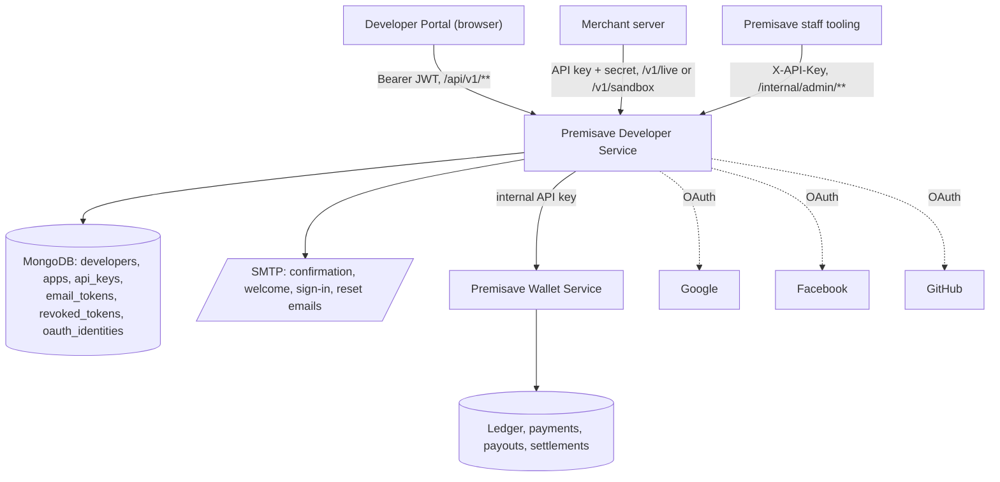
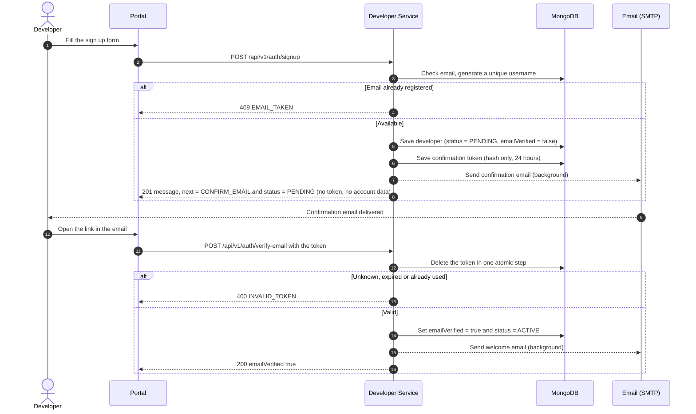
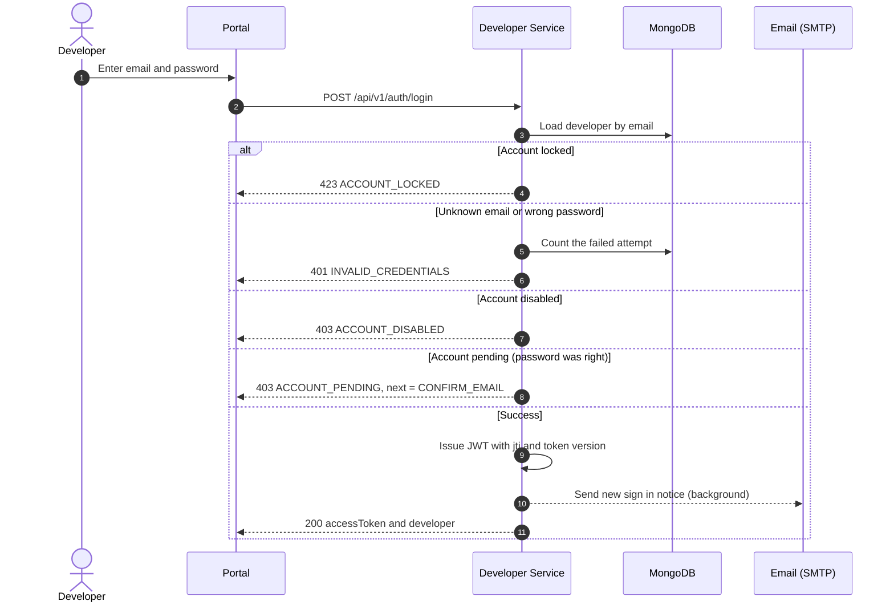
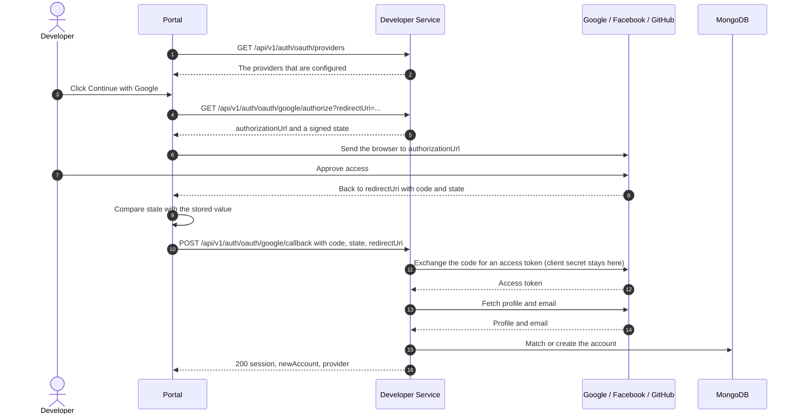
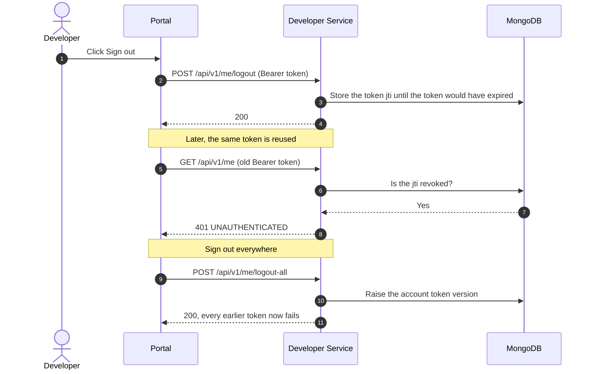
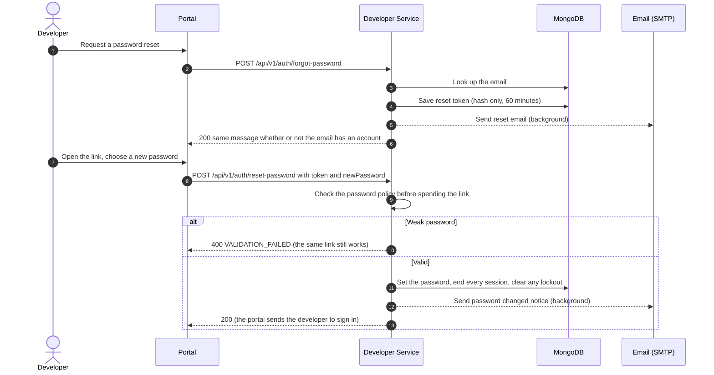
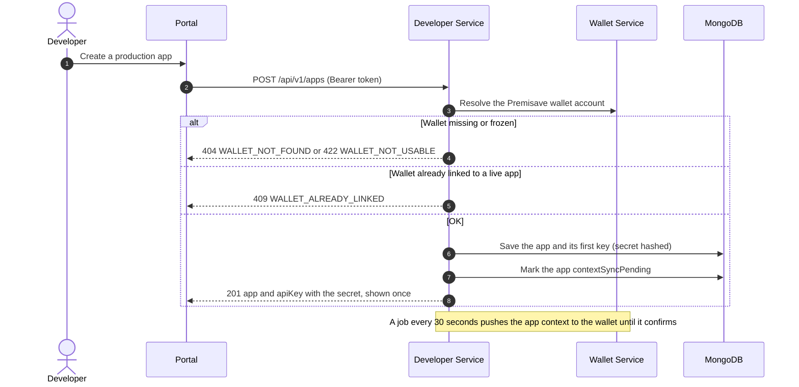
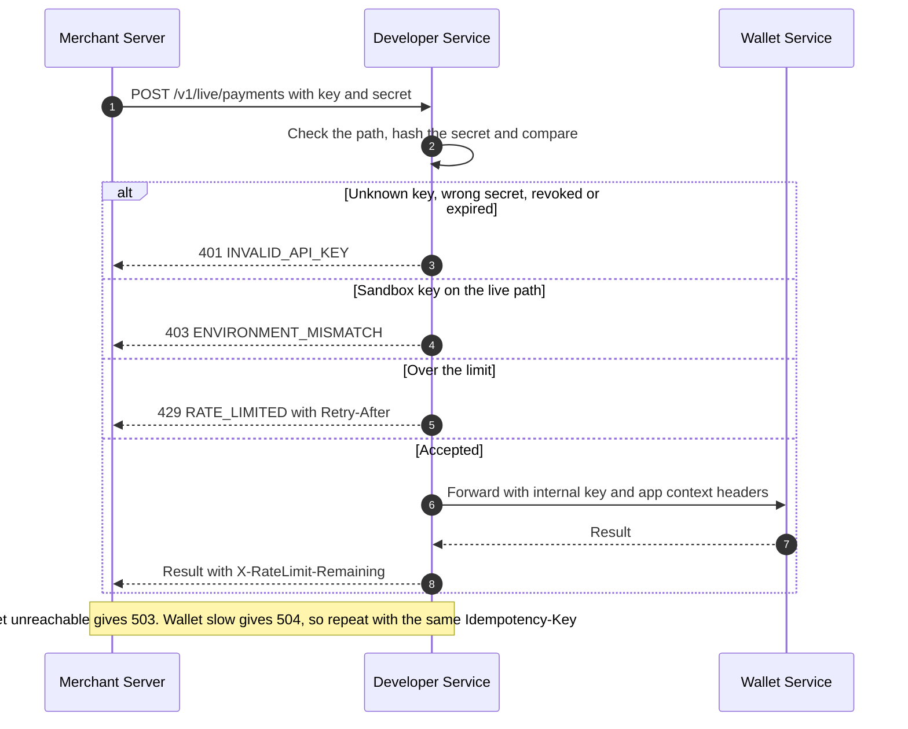

<div align="center">


<a href="https://readme-typing-svg.demolab.com/">
  
</a>

<a href="https://readme-typing-svg.demolab.com/">
  
</a>

<br/>

[](#tech-stack)
[](#tech-stack)
[](#tech-stack)
[](#security-highlights)
[](#getting-started)
[](#api-reference)

<br/>

[](#email-setup)
[](#social-sign-in-setup)
[](#social-sign-in-setup)
[](#social-sign-in-setup)

</div>

<br/>

## Menu

- [Overview](#overview)
- [Features](#features)
- [Tech Stack](#tech-stack)
- [Architecture](#architecture)
- [Sequence Diagrams](#sequence-diagrams)
  - [Sign Up and Email Confirmation](#sign-up-and-email-confirmation)
  - [Sign In](#sign-in)
  - [Social Sign In](#social-sign-in)
  - [Logout and Token Revocation](#logout-and-token-revocation)
  - [Forgot Password](#forgot-password)
  - [Create an App and Its First Key](#create-an-app-and-its-first-key)
  - [A Merchant Calls the Public API](#a-merchant-calls-the-public-api)
- [API Reference](#api-reference)
- [Getting Started](#getting-started)
  - [Generating Secrets](#generating-secrets)
- [Environment Variables](#environment-variables)
- [Profile Pictures](#profile-pictures)
- [Email Setup](#email-setup)
- [Social Sign In Setup](#social-sign-in-setup)
  - [Trying It in a Browser](#trying-it-in-a-browser)
- [Testing](#testing)
- [Project Structure](#project-structure)
- [Security Highlights](#security-highlights)
- [Running More Than One Instance](#running-more-than-one-instance)
- [Database Indexes](#database-indexes)
- [Known Gaps](#known-gaps)
- [Roadmap](#roadmap)
- [Contributing](#contributing)
- [License](#license)
- [Author](#author)

<br/>

## Overview

**Premisave Developer Service** is the front door for developers who build on the Premisave payment platform. It owns everything about *who a developer is and what they are allowed to call*: accounts, sign in, email confirmation, password recovery, profiles and usernames, the developer's business, sandbox and production apps, and the API keys and secrets those apps use.

It is also the public entry for payments. A merchant's server calls `https://<developer-service>/v1/live/...` or `/v1/sandbox/...` with its key and secret. This service authenticates the key, applies a rate limit and the app's rules, and forwards the call to the **wallet service**, which does the actual payments. The wallet is never exposed to merchants.

It is a standalone Spring Boot service with its own database (`premisave_developer`), separate from the wallet service.

| Service | Port | Owns |
|---|---|---|
| `premisave-developer-service` (this one) | 8091 | Developers, apps, API keys, the public `/v1` entry |
| `premisave-wallet-service` | 8084 | Merchants, onboarding review, ledger, payments, payouts, settlements |

The design, ownership table and failure behaviour are in [DEVELOPER_SERVICE_SPLIT.md](DEVELOPER_SERVICE_SPLIT.md). Every endpoint, with request and response examples, is in [DEVELOPER_API.md](DEVELOPER_API.md).

<br/>

## Features

**Accounts and Authentication**
- Email and password sign up with first, optional middle and last name, country, optional phone and company, and an accepted-terms record. Sign up leaves the account `PENDING` until the email is confirmed, then it becomes `ACTIVE`. It returns only a message, the next step (`CONFIRM_EMAIL`) and the status: no token and no account data, so the portal tells the developer to open the confirmation link. A `PENDING` account cannot sign in, with a password or through Google, Facebook or GitHub, and no token works for it: the answer is `403 ACCOUNT_PENDING` until the email is confirmed.
- Sign in with Google, Facebook or GitHub through the authorization code flow, so the portal never handles a provider secret
- Stateless HS256 JWT access tokens (`jti`, token version) with real revocation: sign out one device, or sign out everywhere
- Email confirmation and forgot password, using single-use links that are stored only as keyed hashes
- Lockout after 5 failed sign-ins for 15 minutes, PBKDF2 password hashing, and identical answers for unknown email and wrong password
- Change password for signed-in developers, including setting a first password on an account created through a provider

**Profiles and Usernames**
- Editable profile: names, country, phone, company, address, city, state or region, postal code, time zone, marketing opt-in
- A username is generated at sign up (`wanjiku.kamau`) and can be changed once every 7 days
- Username checks: ASCII only, 3 to 30 characters, unique whatever the case, reserved words refused, brand names such as `premisave`, `safaricom` and `mpesa` refused even when separators try to hide them
- A live availability check for the profile form
- A profile picture (JPEG, PNG or WebP, up to 5 MB) stored in Cloudinary, replaced by uploading a new one and removed on request

**Account Emails**
- Five HTML emails: confirm your account, welcome, new sign in notice (time, method, device, network address), reset your password, and password changed
- Sent in the background, so a slow mail server never slows an endpoint, and a mail failure never fails a request
- Gmail works out of the box with an App Password; with no mail server configured the service sends nothing and still answers normally

**Apps and API Keys**
- Up to 10 apps per environment, each `sandbox` or `production`, with its own keys
- Production apps need the merchant's own number and a linked Premisave wallet, and one live app per wallet is enforced by a unique index
- Per-app narrowing of payment methods and limits that can never widen what the merchant already has
- Keys come with a secret shown once. Rotation keeps the old key working for a grace period, revocation is immediate
- App suspension by the developer or by staff. A suspension placed by staff cannot be lifted by the developer

**Public API Entry**
- `/v1/{live|sandbox}/**` forwards GET, POST, PUT, PATCH and DELETE to the wallet with the app's context
- API key and secret by HTTP Basic or `X-Client-Key` and `X-Client-Secret` headers
- Per key rate limit, a 1 MB body cap, strict path checks, and a small allow list of headers in both directions
- The wallet's errors are translated into this service's error codes, and an unreachable or slow wallet becomes `503` or `504`

**Business and Onboarding**
- One business per developer, created as a merchant in the wallet service once the email is confirmed
- `/api/v1/merchant/application/**` passes the developer's onboarding application and document uploads (up to 12 MB) through to the wallet

**Platform Concerns**
- One response envelope everywhere and an `X-Request-Id` header on every response
- Staff endpoints to suspend an app or disable a developer
- Postman collection with 53 requests, ready to import

<br/>

## Tech Stack

| Layer | Technology |
|---|---|
| Language / Runtime | Java 21 |
| Framework | Spring Boot 4.1.1 (Spring Web MVC, Spring Data MongoDB, Bean Validation, Spring Mail) |
| Database | MongoDB (its own database, `premisave_developer`) |
| Authentication | HS256 JSON Web Tokens and PBKDF2WithHmacSHA256 from the JDK. No Spring Security |
| API keys | Secrets hashed with HMAC-SHA256 and a server-side pepper |
| Social Sign-In | Google, Facebook and GitHub over the JDK HTTP client |
| Email | Spring Mail (SMTP) and HTML template files |
| Wallet access | Internal REST client with an internal API key and optional request signing |
| Build Tool | Maven |

<br/>

## Architecture



Three surfaces share one service:

| Surface | Path | Who calls it | Authentication |
|---|---|---|---|
| Portal API | `/api/v1/**` | The developer portal | `Authorization: Bearer <accessToken>`, except `/api/v1/auth/**` |
| Public API | `/v1/{live\|sandbox}/**` | Merchants' servers | API key and secret |
| Admin API | `/internal/admin/**` | Premisave staff tooling | `X-API-Key: <DEVELOPER_INTERNAL_API_KEY>` |

<br/>

## Sequence Diagrams

### Sign Up and Email Confirmation



Sign up issues no token and returns no account data. The account is `PENDING` until the email link is used, which makes it `ACTIVE` (so does a password reset from an email link, or joining through a provider that vouches for the address). The portal shows `data.message` and tells the developer to open the confirmation link. Until then sign in answers `403 ACCOUNT_PENDING`, and a new link can be requested from the sign in page with `POST /api/v1/auth/resend-verification`. Sign up never fails because the email could not be sent. A confirmed email is required before the developer can create a business.

### Sign In



An unknown email still pays for one password hash, so timing does not reveal which emails have accounts. Five failures lock the account for 15 minutes.

### Social Sign In



An existing account is joined only when the provider vouches for the email address (Google and GitHub do, Facebook does not). The full matching table is in [DEVELOPER_API.md](DEVELOPER_API.md) section 1.9.

### Logout and Token Revocation



Revoked ids clean themselves up through a TTL index, so there is no cleanup job.

### Forgot Password



### Create an App and Its First Key



### A Merchant Calls the Public API



The client's key and secret are never forwarded to the wallet.

<br/>

## API Reference

All endpoints are prefixed with the service's base URL (`http://localhost:8091` locally).

 no token needed &nbsp;&nbsp;
 valid Bearer token required &nbsp;&nbsp;
 API key and secret required &nbsp;&nbsp;
 `X-API-Key` header required, no user token

Every response uses the same envelope, and every response carries an `X-Request-Id` header:

```json
{ "success": true, "message": "Account retrieved", "data": { }, "timestamp": "2026-10-16T09:30:00.123" }
```

**Auth** — `/api/v1/auth`

| Method | Endpoint | Access | Description |
|---|---|---|---|
| POST | `/api/v1/auth/signup` |  | Create an account (no token, sign in next) |
| POST | `/api/v1/auth/login` |  | Email and password sign in |
| POST | `/api/v1/auth/verify-email` |  | Confirm an email with the emailed token |
| POST | `/api/v1/auth/resend-verification` |  | Ask for a new confirmation email |
| POST | `/api/v1/auth/forgot-password` |  | Start a password reset |
| POST | `/api/v1/auth/reset-password` |  | Complete a password reset |
| GET | `/api/v1/auth/oauth/providers` |  | Providers that are configured |
| GET | `/api/v1/auth/oauth/{provider}/authorize` |  | Get the provider sign in address and state |
| POST | `/api/v1/auth/oauth/{provider}/callback` |  | Finish a Google, Facebook or GitHub sign in |

**Account** — `/api/v1/me`

| Method | Endpoint | Access | Description |
|---|---|---|---|
| GET | `/api/v1/me` |  | The current developer |
| PUT | `/api/v1/me` |  | Update profile, address and username |
| GET | `/api/v1/me/username-available?username=` |  | Check a username before saving |
| PUT | `/api/v1/me/profile-picture` |  | Upload or replace the profile picture (the body is the image) |
| DELETE | `/api/v1/me/profile-picture` |  | Remove the profile picture |
| PUT | `/api/v1/me/password` |  | Change or first set a password |
| POST | `/api/v1/me/logout` |  | Revoke the current token |
| POST | `/api/v1/me/logout-all` |  | Revoke every token on every device |
| POST | `/api/v1/me/resend-verification` |  | Resend the confirmation email |

**Business** — `/api/v1/merchant`

| Method | Endpoint | Access | Description |
|---|---|---|---|
| POST | `/api/v1/merchant` |  | Create the developer's business (needs a confirmed email) |
| GET | `/api/v1/merchant` |  | The business, as the wallet sees it |
| ANY | `/api/v1/merchant/application/**` |  | Onboarding application pass-through (GET, POST, PUT, PATCH, DELETE) |
| GET | `/api/v1/meta/test-merchant-numbers` |  | Merchant numbers usable in sandbox apps |

**Apps** — `/api/v1/apps`

| Method | Endpoint | Access | Description |
|---|---|---|---|
| POST | `/api/v1/apps` |  | Create an app, returns its first key and secret |
| GET | `/api/v1/apps` |  | List apps (`environment`, `status`, `page`, `size`) |
| GET | `/api/v1/apps/{appId}` |  | One app |
| PUT | `/api/v1/apps/{appId}` |  | Change name, methods, limits or callback URL |
| POST | `/api/v1/apps/{appId}/suspend` |  | Suspend the app |
| POST | `/api/v1/apps/{appId}/reactivate` |  | Lift a suspension the developer placed |

**API Keys** — `/api/v1/apps/{appId}/keys`

| Method | Endpoint | Access | Description |
|---|---|---|---|
| GET | `/api/v1/apps/{appId}/keys` |  | List keys, without secrets |
| POST | `/api/v1/apps/{appId}/keys` |  | Create a key, the secret is shown once |
| POST | `/api/v1/apps/{appId}/keys/{key}/rotate` |  | Issue a new key, the old one keeps working for the grace period |
| DELETE | `/api/v1/apps/{appId}/keys/{key}` |  | Revoke a key at once |

**Public API** — `/v1`

| Method | Endpoint | Access | Description |
|---|---|---|---|
| GET, POST, PUT, PATCH, DELETE | `/v1/live/**` |  | The wallet's commercial API, production |
| GET, POST, PUT, PATCH, DELETE | `/v1/sandbox/**` |  | The same API against sandbox data |

Authenticate with `Authorization: Basic base64(key:secret)` or with the headers `X-Client-Key` and `X-Client-Secret`. A `pk_sandbox_` key works on `/v1/sandbox` only, and a `pk_live_` key on `/v1/live` only. The payment operations themselves are documented in the wallet's `COMMERCIAL_API_ENDPOINTS.md`: a path such as `POST /payments` there is `POST /v1/live/payments` here.

**Admin** — `/internal/admin`

| Method | Endpoint | Access | Description |
|---|---|---|---|
| GET | `/internal/admin/apps/{appId}` |  | Any app |
| PUT | `/internal/admin/apps/{appId}/status` |  | Suspend or reactivate an app (a reason is required to suspend) |
| PUT | `/internal/admin/developers/{developerId}/status` |  | Disable or enable a developer |

`Internal` endpoints authenticate exclusively with the `X-API-Key` header matching `DEVELOPER_INTERNAL_API_KEY`. With no key configured, every call returns `401`.

Request and response examples for every endpoint, plus the full list of error codes, are in [DEVELOPER_API.md](DEVELOPER_API.md). A ready-to-import Postman collection and environment are in `postman/`.

<br/>

## Getting Started

### Prerequisites

- Java 21+
- Maven 3.9+
- MongoDB running locally (or reachable through the URI you configure)
- The wallet service running, for anything that creates a business, creates a production app or calls `/v1`
- A Gmail account (or any SMTP service) for outbound email. Optional
- OAuth credentials for whichever social providers you want to enable. Optional

### Installation

```bash
cd premisave-developer-service
cp .env.example .env
```

Fill in `.env` (see [Environment Variables](#environment-variables)), then run:

```bash
mvn spring-boot:run
```

The service starts on `http://localhost:8091` by default. It refuses to start without `DEVELOPER_JWT_SECRET` and `API_KEY_PEPPER`. Without `INTERNAL_API_KEY` it starts, but every call that needs the wallet fails.

The service reads a file named `.env` from the folder it is started in (`spring.config.import` in `application.yml`), so start it from the project folder, which is where IntelliJ starts it too. Real environment variables win over the file. Keep the file in plain `KEY=value` lines with no quotes. `.env` holds secrets, so it must stay in `.gitignore` (the one in this repository already lists it, and keeps `.env.example` tracked).

You can also skip the file and export the variables instead:

```bash
export DEVELOPER_JWT_SECRET=...      # at least 32 characters
export API_KEY_PEPPER=...            # at least 16 characters
export INTERNAL_API_KEY=...          # same value as the wallet's INTERNAL_API_KEY
export WALLET_SERVICE_URL=http://localhost:8084
mvn spring-boot:run
```

### Generating Secrets

`DEVELOPER_JWT_SECRET` (at least 32 characters), `API_KEY_PEPPER` (at least 16) and `DEVELOPER_INTERNAL_API_KEY` should be random. Make each one with:

```bash
openssl rand -base64 32
```

Run it once per secret and paste the output after the `=` in `.env`. Use a different value for each, and do not reuse them across environments. Changing `API_KEY_PEPPER` later invalidates every API key, and changing `DEVELOPER_JWT_SECRET` signs everyone out.

<br/>

## Environment Variables

All settings live in `.env.example` and `src/main/resources/application.yml`.

| Variable | Purpose |
|---|---|
| `SERVER_PORT` | HTTP port, default `8091` |
| `MONGODB_URI` | MongoDB connection string, default `mongodb://localhost:27017/premisave_developer`. Use a database separate from the wallet's |
| `DEVELOPER_JWT_SECRET` | Signs portal tokens. Required, at least 32 characters |
| `API_KEY_PEPPER` | Keys the hash of every API secret and every email link. Required, at least 16 characters |
| `WALLET_SERVICE_URL` | Where the wallet service runs, default `http://localhost:8084` |
| `INTERNAL_API_KEY` | The wallet's internal key. Must equal the wallet's `INTERNAL_API_KEY` |
| `WALLET_SIGNING_SECRET` | Only when the wallet has request signing on. Must be one of its `commercial.signing.secrets` |
| `DEVELOPER_INTERNAL_API_KEY` | Guards `/internal/admin`. Empty means those endpoints refuse every call |
| `DEVELOPER_PORTAL_ORIGINS` | Browser origins allowed to call `/api/v1`, comma separated. `/v1` is never opened to browsers |
| `DEVELOPER_PORTAL_URL` | Where the portal runs. Links in emails point here |
| `DEVELOPER_MAIL_FROM` | Sender address on every email |
| `MAIL_HOST`, `MAIL_PORT`, `MAIL_USERNAME`, `MAIL_PASSWORD` | The SMTP server. Host defaults to `smtp.gmail.com` and port to `587`. An empty `MAIL_USERNAME` means no email is sent. See [Email Setup](#email-setup) |
| `MAIL_SMTP_AUTH`, `MAIL_SMTP_STARTTLS_ENABLE` | Both default to `true`, which is right for Gmail and most providers |
| `DEVELOPER_MAIL_NOTIFY_SIGN_IN` | Email the owner on every sign in, default `true` |
| `DEVELOPER_MAIL_LOG_LINKS` | Development only: write confirmation and reset links to the log when no mail server is set |
| `DEVELOPER_MAIL_STARTUP_CHECK` | Check the mail settings at every start and log the result, default `false`. See [Email Setup](#email-setup) |
| `DEVELOPER_MAIL_STARTUP_CHECK_SEND_TO` | With the check on, also send one test email to this address at every start. Empty means none |
| `CLOUDINARY_CLOUD_NAME`, `CLOUDINARY_API_KEY`, `CLOUDINARY_API_SECRET` | Where profile pictures are stored, from the Cloudinary dashboard. With any of them empty, profile pictures are off and the rest of the service works. See [Profile Pictures](#profile-pictures) |
| `CLOUDINARY_FOLDER`, `CLOUDINARY_MAX_BYTES` | Folder for the pictures (default `premisave/developers`) and the largest picture accepted (default 5 MB, never more than 10 MB) |
| `DEVELOPER_OAUTH_REDIRECT_URIS` | Exact portal callback addresses, comma separated. Empty turns social sign in off |
| `GOOGLE_CLIENT_ID`, `GOOGLE_CLIENT_SECRET` | Google sign in |
| `FACEBOOK_CLIENT_ID`, `FACEBOOK_CLIENT_SECRET` | Facebook sign in |
| `GITHUB_CLIENT_ID`, `GITHUB_CLIENT_SECRET` | GitHub sign in |

Further tuning is in `application.yml` under `developer.*`: token lifetime (`developer.jwt.access-ttl-minutes`, 60), key rotation grace (`developer.keys.rotation-grace-hours`, 24), rate limit (`developer.proxy.rate-limit-per-minute`, 600), apps per environment (10), keys per app (5), lockout (5 failures, 15 minutes), password length (10), link lifetimes (24 hours and 60 minutes) and the app sync interval (30 seconds).

<br/>

## Profile Pictures

A signed-in developer can set a profile picture. It is stored in Cloudinary, and the account shows its address as `profilePictureUrl`.

1. Create a Cloudinary account and copy the cloud name, API key and API secret from its dashboard.
2. Put them in `.env`:
   ```properties
   CLOUDINARY_CLOUD_NAME=
   CLOUDINARY_API_KEY=
   CLOUDINARY_API_SECRET=
   ```
3. Restart the service.

Things to know:

- **Upload:** `PUT /api/v1/me/profile-picture` with the image file itself as the request body and a matching `Content-Type` (`image/jpeg`, `image/png` or `image/webp`). It is not form data. In a browser: `fetch(url, { method: 'PUT', headers: { Authorization: 'Bearer ...', 'Content-Type': file.type }, body: file })`.
- **Checks:** the file is judged by its first bytes, not by its name or the type the caller claims, and must be a JPEG, PNG or WebP of at most 5 MB. Anything else is `400 VALIDATION_FAILED`, a larger file is `413 PAYLOAD_TOO_LARGE`.
- **Replacing:** each developer has one picture, stored as `premisave/developers/<developerId>`. A new upload overwrites it, so nothing is left behind, and the old address stops being served. Cloudinary keeps the picture within 1024 by 1024 pixels.
- **Removing:** `DELETE /api/v1/me/profile-picture` deletes it from Cloudinary and clears it from the account. It is safe to repeat.
- **Secret:** the API secret stays in this service. Uploads are signed here and sent to Cloudinary from the server, and the secret is never printed in logs or returned.
- **Not set up:** with the cloud name, key or secret empty, the two endpoints answer `503 UPSTREAM_UNAVAILABLE` and nothing else is affected. The same code is returned when Cloudinary cannot be reached.
- **Why not form data:** the public API proxy reads raw request bodies, and turning on Spring's form upload handling would consume them before the proxy sees them.

<br/>

## Email Setup

Email is optional and off until a mail username is set. With no `MAIL_USERNAME`, no email is sent, a warning is logged, and every endpoint still answers normally.

**Gmail**

1. Turn on 2-step verification for the Google account.
2. Create an App Password at <https://myaccount.google.com/apppasswords>. It has 16 characters. Your normal account password will not work.
3. Put these in `.env`:
   ```properties
   DEVELOPER_MAIL_FROM=you@gmail.com
   MAIL_HOST=smtp.gmail.com
   MAIL_PORT=587
   MAIL_USERNAME=you@gmail.com
   MAIL_PASSWORD=your16characterapppassword
   MAIL_SMTP_AUTH=true
   MAIL_SMTP_STARTTLS_ENABLE=true
   MAIL_SMTP_STARTTLS_REQUIRED=true
   ```
4. Restart the service and sign up. The confirmation email should arrive within seconds.

Things to know:

- `MAIL_HOST` is the server name, never an email address. It defaults to `smtp.gmail.com`, so for Gmail you can leave it out.
- A password pasted as `' yyyy nnnn bbbb kkkk'` still works: the service removes one pair of matching quotes and the spaces of a Google App Password before it logs in (and says so in the log, without showing the password). Any other password is used exactly as written. Plain `yyyynnnnbbbbkkkk` is still the clean form.
- The capital-letter `MAIL_*` names are the same style as the wallet service, and they work in `.env` and as real environment variables. The old `SPRING_MAIL_*` names are not read: if `.env` still has them, the startup check tells you to rename them.
- With no `MAIL_USERNAME`, mail is off. Spring itself switches mail on for any host value, and the Gmail default always gives it one, so the service decides: mail is on only when both a host and a username are set.
- Gmail sends as the signed-in account whatever `From` says, so keep `DEVELOPER_MAIL_FROM` equal to the username.
- A personal Gmail account allows about 500 messages a day. That is enough for development but not for a launch. Use a transactional email service (any SMTP provider) in production.
- For local work without a mail server, `DEVELOPER_MAIL_LOG_LINKS=true` writes the confirmation and reset links to the log. Links are credentials, so never use it in production.

**Check mail at startup**

Set `DEVELOPER_MAIL_STARTUP_CHECK=true` in `.env` and the service checks its mail settings every time it starts, a moment after it is ready, and writes the result to the log. Look for lines beginning `Mail check:`:

| Log line | Meaning |
|---|---|
| `mail is OFF. No mail username (or host) is set` | Mail is not configured. The same line then says why: no `.env` file in the folder the service started from (with the full path it looked in), no `MAIL_USERNAME` line, a line starting with `#`, or an empty value. Fix `.env` and restart |
| `mail is ON. Server smtp.gmail.com:587, user ..., password 16 characters` | Mail is configured. The password is never printed, only its length |
| `the mail server accepted the login` | The username and App Password are right |
| `the mail server did not accept the login` | Wrong username or password. For Gmail use the 16 character App Password |
| `test email sent to ...` | A test email was sent. Check the inbox and the spam folder |

To get a test email at every start, also set `DEVELOPER_MAIL_STARTUP_CHECK_SEND_TO=you@example.com`. Clear it, or set the check to `false`, once mail works, or every start sends a message. The check runs in the background, so a slow mail server never delays startup, and nothing it finds stops the service from starting. Mail server connections also time out after 10 seconds. To run the same check as a test instead, see [Testing](#testing).

**The emails**

| Email | When |
|---|---|
| Confirm your Premisave developer account | Sign up, and every resend |
| Welcome to Premisave | The moment the address becomes confirmed |
| New sign in to your account | Every successful sign in except the one that creates the account. Turn off with `DEVELOPER_MAIL_NOTIFY_SIGN_IN=false` |
| Reset your password | A forgot-password request for an active account |
| Your password was changed | After a password change or reset |

The emails are HTML files in `src/main/resources/email/` (`layout.html` is the frame, the others are the bodies), with `{{placeholders}}` and HTML-escaped values. Previews of all five are in `email-previews/`, so open them in a browser to see them. Behind a reverse proxy, set `server.forward-headers-strategy=native` so the sign-in notice shows the caller's address instead of the proxy's. More in [DEVELOPER_API.md](DEVELOPER_API.md) section 1.11.

<br/>

## Social Sign In Setup

Google, Facebook and GitHub follow one pattern. The portal asks this service for an authorization address, sends the browser to the provider, and posts the returned `code` back to this service, which exchanges it using the client secret and returns its own JWT. The secrets never reach the browser.

A provider is on when it has both a client ID and a secret. Nothing works until `DEVELOPER_OAUTH_REDIRECT_URIS` lists the exact portal addresses the provider may send people back to, for example:

```properties
DEVELOPER_OAUTH_REDIRECT_URIS=http://localhost:3000/auth/callback/google,http://localhost:3000/auth/callback/facebook,http://localhost:3000/auth/callback/github
```

Register the same addresses with each provider. There are no wildcards, and the address sent at the start must match the one sent at the end exactly.

| Provider | Create the app in | Scopes requested | `.env` values |
|---|---|---|---|
| Google | Google Cloud console, APIs and Services, Credentials, OAuth client ID of type **Web application** | `openid email profile` | `GOOGLE_CLIENT_ID`, `GOOGLE_CLIENT_SECRET` |
| Facebook | Meta for Developers, an app with the Facebook Login use case | `email,public_profile` | `FACEBOOK_CLIENT_ID`, `FACEBOOK_CLIENT_SECRET` |
| GitHub | GitHub, Settings, Developer settings, OAuth Apps | `read:user user:email` | `GITHUB_CLIENT_ID`, `GITHUB_CLIENT_SECRET` |

Notes per provider:

- **Google.** Add each callback address under **Authorized redirect URIs**. While the consent screen is in Testing, add the accounts you sign in with under Test users.
- **Facebook.** Add the `email` permission to the Login use case, or tokens carry no email and sign in fails with `OAUTH_EMAIL_REQUIRED`. While the app is in Development mode, only accounts with a role on the app can sign in. Facebook never counts as vouching for an address, so a Facebook email that matches an existing account is refused with `ACCOUNT_EXISTS` and the developer signs in the old way. A first Facebook sign in creates the account as `PENDING`, sends the confirmation link and answers `403 ACCOUNT_PENDING` with no session; the developer signs in with Facebook again after opening the link. The default endpoints pin Graph API `v21.0`. Check it against Facebook's current version and override `developer.oauth.facebook.authorize-url`, `token-url` and `user-info-url` if needed.
- **GitHub.** Set the Authorization callback URL to the portal address. Only verified addresses from the account's email list are used, with the primary one preferred.

The check for a working setup is `GET /api/v1/auth/oauth/providers`, which lists the providers that are on. The full flow, matching rules and error codes are in [DEVELOPER_API.md](DEVELOPER_API.md) section 1.9.

### Trying It in a Browser

The `oauth-test` folder holds a single page, `social-login-test.html`, that runs the whole flow against this service so you can test Google, Facebook and GitHub sign up and sign in without building the portal first. It needs no client ID or secret, because those stay in `.env`. It asks `GET /api/v1/auth/oauth/providers` which providers are on and enables only those buttons.

1. Add the page's return address and origin to `.env`, then restart the service:

```properties
DEVELOPER_OAUTH_REDIRECT_URIS=http://localhost:3000/social-login-test.html
DEVELOPER_PORTAL_ORIGINS=http://localhost:3000
```

2. Register `http://localhost:3000/social-login-test.html` as the redirect or callback address in the Google, Facebook and GitHub consoles. It must match character for character.
3. Serve the folder and open the page. Opening the file directly does not work, because the providers need a real address to send people back to:

```bash
cd oauth-test
python3 -m http.server 3000
```

Then open `http://localhost:3000/social-login-test.html`.

The page has two modes. **Sign in to Premisave** runs the flow to the end, shows the access token and the developer that came back, and lets you call `GET /api/v1/me` and `POST /api/v1/me/logout`. **Get the code only** stops when the provider returns, and shows the code and state with a ready request body for `POST /api/v1/auth/oauth/{provider}/callback`, so you can send it from Postman. A code works once. If the state the provider returns is not the one this service issued, the page refuses it, which is the check the portal must also make.

Run the first sign in with a new email to see the account created, then run it again to see the same account signed in. Check `newAccount` and `status` in the result.

<br/>

## Testing

```bash
mvn clean test
```

The tests use fakes for the repositories and a local HTTP server standing in for the wallet, so they need no database and no network. This code base was compiled and its tests run only with `javac` against stubs, never with Maven or a real MongoDB, SMTP server, wallet or provider. Run this first on your machine.

To check that email is really switched on in your setup, run the mail check. It starts the application, reads your `.env`, and reports whether the mail host was picked up and whether the mail server accepts the login. It sends nothing unless you add an address, and it is skipped in a normal build:

```bash
mvn test -Dtest=MailConfigurationCheckTest -Dmail.check=true
mvn test -Dtest=MailConfigurationCheckTest -Dmail.check=true -Dmail.check.send-to=you@example.com
```

In IntelliJ, run `MailConfigurationCheckTest` with the VM option `-Dmail.check=true`, from the project folder. MongoDB must be running.

For manual testing, import both files from `postman/` into Postman: the collection has 53 requests grouped as account, email and password, social sign in, onboarding, apps, API keys, the public API and the admin API.

To try Google, Facebook and GitHub sign in in a browser, use the page in `oauth-test`. See [Trying It in a Browser](#trying-it-in-a-browser).

<br/>

## Project Structure

```
src/main/java/com/premisave/developer
├── PremisaveDeveloperServiceApplication.java
├── controller    # REST endpoints: Auth, Me (profile, picture, business), OAuth, App, Key, Admin, the public /v1 entry
├── service       # Business logic: accounts, email links, OAuth, apps, API keys, proxy, profile pictures, mail check
├── repository    # Spring Data MongoDB repositories, one per collection
├── model         # Mongo documents: Developer, DeveloperApp, ApiKey, EmailToken, RevokedToken, OAuthIdentity, Limits
├── enums         # Statuses, environments, method types, error codes, email token types, OAuth providers
├── dto           # Request bodies, the response envelope, and small value types passed between layers
├── view          # Turns models into the maps the API returns (developer, app, key, page)
├── client        # Calls to other systems: the wallet, sign in providers, Cloudinary, SMTP, and the HTTP transports
├── security      # Password hashing, JWT, OAuth state, the rate limiter, the two interceptors
├── config        # Properties (developer.*), web and security beans, mail and picture storage wiring
├── filter        # The request id filter
├── exception     # DeveloperException and the global error handler
└── util          # Ids, hashing, JSON reading, names, usernames, profile fields, password rules, email templates, response helpers

src/main/resources
├── application.yml
└── email         # layout.html and the five email bodies

postman           # Collection (53 requests) and local environment
oauth-test        # A browser page for trying Google, Facebook and GitHub sign in (see Social Sign In Setup)
email-previews    # The five emails rendered, open in a browser
```

<br/>

## Security Highlights

- **Passwords** use PBKDF2WithHmacSHA256 from the JDK with a per-password salt. An unknown email still pays for one hash, and the answer is the same as for a wrong password.
- **Stateless JWTs that can still be revoked.** Every token has a `jti`. Signing out stores it until the token would have expired, and signing out everywhere raises the account's token version. Changing or resetting a password does the same.
- **API secrets are shown once.** Only a keyed hash (HMAC-SHA256 with the pepper) and the last characters for display are stored. Secret and internal key comparisons are constant time, and unknown keys cost one hash so timing does not reveal which keys exist.
- **Email links are single use.** A link carries 32 random bytes, only a keyed hash is stored, and redeeming deletes the row in one atomic step, so two requests cannot both succeed with one link.
- **No account enumeration by answer.** Forgot password, resend confirmation and sign in give the same answer for known and unknown emails.
- **A tamper-proof OAuth state.** It is signed, expires after 10 minutes, and is bound to the provider and the redirect address. Redirect addresses must be on an allow list, provider replies are capped at 256 KB, redirects are not followed, and calls time out after 10 seconds.
- **Safe account joining.** A social sign in joins an existing account only when the provider vouches for the email. If that account never confirmed its address, its password is removed and its sessions end, because whoever typed that password never proved they own the mailbox.
- **Strict public path handling.** `/v1` refuses dot segments, encoded dots and slashes, backslashes, semicolons, whitespace and control characters, caps bodies at 1 MB, forwards a small allow list of headers, and never forwards the client's credentials.
- **Usernames and profile text are checked.** ASCII-only usernames defeat look-alike letters, brand names are blocked through separators, and free text refuses `<`, `>` and control characters. Values placed in emails are HTML-escaped.
- **No plaintext secrets in source control.** Configuration comes from the environment or an ignored `.env`.
- **Consistent, human-readable errors.** Every failure returns the same JSON envelope with a code and a request id, never a stack trace.
- **Browsers only reach the portal API.** CORS is opened for `/api/v1` and only for the configured origins, never for `/v1`.
- **The wallet must not be public.** The context headers sent to the wallet are protected by the internal key and network isolation, not by the request signature. Expose only this service to the internet.

<br/>

## Running More Than One Instance

The rate limiter counts per instance, so with N instances behind a load balancer the effective limit per key is N times `developer.proxy.rate-limit-per-minute`. The app sync job (every 30 seconds) is safe to run on several instances: the wallet ignores an app version it already holds, and an app is only cleared when its version did not change during the push. If this service is down, no merchant traffic gets through, so run at least two instances in production.

<br/>

## Database Indexes

Created at startup (`spring.data.mongodb.auto-index-creation: true`):

| Collection | Index |
|---|---|
| `developers` | `email` (unique), `username` (unique, sparse), `merchantId` (unique, sparse) |
| `apps` | `developerId`, `premisaveWalletId` (unique, sparse, the one-live-app-per-wallet guarantee), `contextSyncPending` |
| `api_keys` | `appId` |
| `email_tokens` | `tokenHash` (unique), `developerId`, TTL on `expiresAt` |
| `revoked_tokens` | TTL on `expiresAt`, so revoked tokens clean themselves up |
| `oauth_identities` | Keyed by `provider:subject`, index on `developerId` |

If your Mongo user cannot create indexes, create these by hand. The wallet guarantee and the username rule depend on the unique ones.

<br/>

## Known Gaps

- `GET /api/v1/me/username-available` needs a sign in but has no rate limit of its own. Limit it at the gateway.
- There is no per-IP rate limit on sign in, sign up, forgot password and the OAuth callback. Put one at the gateway. Accounts are protected by lockout and per-account link limits, not by source address.
- Event and webhook delivery to merchant URLs is not built yet. Leave the wallet's `DEVELOPER_SERVICE_URL` empty so events wait in its outbox.
- A provider cannot be linked from inside a signed-in account yet.
- The OAuth state is not tied to the browser by a cookie, so the portal must compare it with the value it stored. There is no PKCE.
- Emails have no plain-text part and no localisation. They were checked in a Chromium-based browser only, so Outlook on desktop will show them plainer and without dark mode.
- Nothing has been run against a real MongoDB, SMTP server, provider or wallet, and Maven has not been run on this code. See [Testing](#testing).

The complete list, with reasons, is in [DEVELOPER_SERVICE_SPLIT.md](DEVELOPER_SERVICE_SPLIT.md) sections 9 and 10.

<br/>

## Roadmap

- [ ] Event and webhook delivery to merchant callback URLs
- [ ] Link and unlink a sign-in provider from account settings
- [ ] Two-factor authentication
- [ ] Per-IP and per-account rate limits on the account endpoints
- [ ] Refresh tokens
- [ ] A staff portal on top of `/internal/admin`
- [ ] OpenAPI documentation
- [ ] Integration tests against a real MongoDB and wallet

<br/>

## Contributing

Contributions are welcome.

1. Fork the repository
2. Create a feature branch (`git checkout -b feature/something-great`)
3. Commit your changes (`git commit -m "Add something great"`)
4. Push to your branch (`git push origin feature/something-great`)
5. Open a Pull Request

Run `mvn clean test` before opening the request.

<br/>

## License

No license has been chosen yet. Add a `LICENSE` file to the repository root to make one official.

<br/>

## Author

<div align="center">


**Bill Graham Peacemaker**

[](https://github.com/peacemakerbill)

</div>

<br/>

